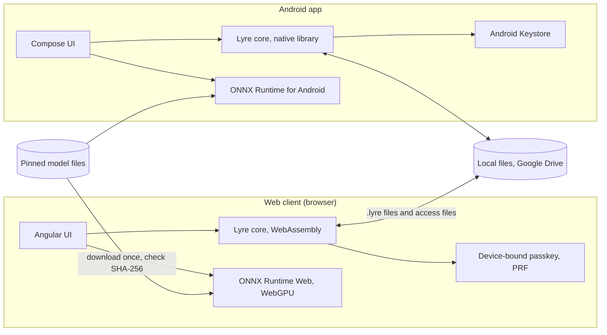

# Lyre architecture

This is the target structure. Sections marked *(planned for Mx)* describe work
that has not been built yet, as defined in
[delivery.md](delivery.md#keeping-the-docs-current). Decisions referenced as
Dn are in [decisions.md](decisions.md).

## Overview



- **Lyre core** is one Rust library (D10). It owns everything both clients
  must agree on: the song file format, encryption, access files, device
  codes, lyric parsing, forced alignment, display line layout, timing, and
  the pinned model files with the check of a download against them. It also
  does the separator's STFT, its inverse and the normalisation around the
  model, and each aligner's input normalisation, log-softmax and vocabulary
  reading. Both clients call it; neither has its own copy of
  this logic.
- **The web client** is a static site (D9). Its UI, media playback and model
  runs are in TypeScript. The UI is Angular with Angular Material (D19),
  built by the rules in [UI conventions](ui-conventions.md). It calls the
  core compiled to WebAssembly. It reads and decodes sources with
  Mediabunny, which is under MPL-2.0. Mediabunny is used unmodified from npm,
  and its licence notice ships in the build's `3rdpartylicenses.txt`.
- **The Android app** is native Kotlin. Its UI, media playback and model runs
  use the Android stack. It calls the core as a native library through
  UniFFI.
- **There is no Lyre server** (D9). Song files and access files move between
  devices however people choose: a shared Drive folder, a chat, a USB stick.
- **Models** are checked by the core against their pinned size and SHA-256
  hash. The client feeds a download to the core in pieces, and the check
  passes only when both match. The web client downloads each file from
  Hugging Face over HTTPS on first use
  ([D21](decisions.md#d21-pinned-model-files-and-the-separator-target--agreed)),
  streaming it to the check and to a `models/` folder in the browser's origin
  private file system (OPFS). It keeps a file only when it passes, and checks
  it again each time it is loaded, because nothing authenticates that storage.
  A file that fails is deleted and never used. The Android app's downloads
  are *(planned for M2)*. The [models reference](reference/models.md) lists
  the pinned files.

## Repository layout

```text
core/                 Rust workspace
  lyre-core/          song file format, crypto, access files, lyrics, alignment, layout,
                      timing, model check, separator spectrogram, aligner vocabularies
  lyre-wasm/          WebAssembly bindings for the web client
  lyre-ffi/           UniFFI bindings for the Android app
  lyre-cli/           developer tool: build and inspect song files, used by tests
web/                  web client: TypeScript, Angular, Angular Material
android/              Android app: Kotlin, Jetpack Compose, Media3
tests/
  e2e/                Playwright journeys against the built web client
  fixtures/           small sources, lyrics, expected timing and test model files for tests
scripts/              one script per check, shared by CI and NexKit
tools/
  model-tool/         developer tool: makes and checks model ONNX files, run by hand
```

Folders are created when the first issue needs them. M0 created `core/` with
`lyre-core`, `lyre-wasm` and `lyre-ffi`, plus `web/`, `android/`, `tests/e2e`
and `scripts/`. M1 added `core/lyre-cli` and `tests/fixtures`, and rebuilt
`web/` on Angular. The [lyre-cli reference](reference/lyre-cli.md) describes
the tool and the fixtures. `tools/model-tool` was added for the M2 model
measurement page. Its [reference](reference/model-tool.md) describes it.
The [models reference](reference/models.md) lists the model files and the
page's measurement method.

## Core rules

- **One implementation.** Anything both clients must do the same way lives in
  the core: parsing, the file format, crypto, layout and timing. A client
  only renders, plays and runs models.
- **No platform code in the core.** The core does no file, network, media or
  GPU work. Clients pass it bytes and call back with bytes. This keeps it
  testable on any machine and the same on both clients.
- **Bounded input.** Every parser in the core has explicit size and count
  limits and rejects input beyond them. Song files come from other people, so
  every byte is untrusted until authenticated.
- **Lyrics are untrusted text.** Lyrics come from other people's song
  files. Both clients render them as text, never as HTML or other markup.
  The web client also turns on Trusted Types and sets a Content Security
  Policy. How it sets that policy without HTTP headers is
  in [knowledge](domain/knowledge.md#running-on-the-users-device).
- **Content keys and private keys never reach JavaScript or Kotlin.** They
  are handled only inside the core and the platform key store. The core's
  API never returns one to a client. It returns an opaque handle that the
  client cannot read *(planned for M3)*. They never reach web UI state,
  Compose state, logs or error messages.

## Song file *(encrypted from M3)*

A `.lyre` file holds one song:

- a fixed header: a magic number, the format version and the song's ID;
- the media in chunks: the video if there is one, the karaoke track and the
  original track;
- the lyrics exactly as supplied, the timing, the song's details and its
  thumbnail.

Display lines are not stored. The core lays them out at play time (D17).

From M3 every chunk is encrypted and authenticated with the song's content
key, so a player can seek by decrypting only the chunks it needs, and a
changed or truncated file is rejected. Format version 0, used in M1 and M2, is
unencrypted, for development only, and is no longer accepted from M3. No
version-0 file is ever published.

The byte layout, limits and media codecs are specified in
[song file format, version 0](reference/song-file-format-v0.md).

## Devices and access *(planned for M3)*

- **Device key.** Created the first time Lyre runs on a device (D8):
  - Android: an EC P-256 key pair in Android Keystore, hardware backed,
    not exportable. Lyre checks its attestation.
  - Web: a device-bound passkey with the PRF extension. The PRF output,
    available only after the user unlocks the device, derives the device's
    key pair inside the core for the session.
    - The browser hands the PRF output to JavaScript. This is the
      only time a secret passes through JavaScript. The client passes it
      straight to the core, then overwrites the buffer with zeros. It never
      keeps the output in state, storage or logs. Clearing is best effort,
      because the JavaScript engine may keep copies.
- **Device code.** The device's public key, encoded as text and a QR code,
  with a short fingerprint for checking it by voice or by eye.
- **Wrapping.** A song's content key is wrapped for a device with HPKE
  (RFC 9180), using a KEM both platforms can run with their hardware-held
  keys. DHKEM(P-256) is the candidate.
- **Access file.** One access file holds one song's content key wrapped for
  one device. The song file does not change when it is shared (D6).
- **Recovery key.** Generated on the owner's request and kept offline, for
  example printed as words or a QR code. Every song the owner makes gets an
  access entry for it too, so a new device can be given access to all of them
  (D7).

The detailed scheme, its threat model and its test vectors are written in a
reference doc and reviewed before M3 implements them.

## Processing *(planned for M2)*

- A task runs the stages in [knowledge](domain/knowledge.md#processing) one
  after another, on one song at a time.
- Each stage writes its output to the task's own working area. A task that
  fails, is cancelled or stops with the app removes that area and leaves no
  song behind. It can start again from the beginning.
- The web client runs a task's stages in a Web Worker, so the page stays
  responsive. Cancel ends the worker at once, because a model run cannot stop
  partway through when asked. The Android app runs them in a foreground
  service the user can see *(planned for M4)*.
- On the web, a task's working area is a `tasks/<task ID>` folder in the
  browser's origin private file system (OPFS). The web client removes any
  working area left behind each time it starts.
- On the web, a browser lock named `lyre-task` keeps one task at a time across
  tabs. The startup cleanup waits for it, so it never removes the area of a
  task still running in another tab.
- On the web, stage 1, reading the source, runs on the main thread as soon as
  a source is picked, for now on the source check page. It reads only the
  container and decodes nothing. Mediabunny reads MP4, WebM and MP3. It reads
  a WebM's tags, but not the segment title where ffmpeg writes a WebM title.
  The core works out the stored type D24 gives the primary video track and
  the primary audio track, from Mediabunny's codec name and codec string. The
  web client asks `MediaSource.isTypeSupported`, as the Player does, and
  refuses the source when a track has no stored type or this browser cannot
  play it. MP3 is stored as `audio/mp4; codecs="mp4a.6B"`.
- On the web, stage 2 decodes the source's audio with Mediabunny through
  WebCodecs, piece by piece, so neither the source nor the decoded audio is
  held whole. A streaming resampler in the web client gives 44.1 kHz stereo
  for separation or 16 kHz mono for alignment. Time counts from the
  timeline's start: audio that starts later gets leading silence. Audio the
  browser cannot decode gets the no-audio refusal. For now it runs on the main
  thread from the source check page.
- The web client runs a model with ONNX Runtime Web (MIT), at a pinned
  version, in a Web Worker. It uses WebGPU when the browser gives it a GPU
  adapter and the session opens on it, and otherwise WebAssembly on one
  thread. The worker gets only model bytes that already passed their check.
  ONNX Runtime's WebAssembly file is served from the site itself, at `ort/`,
  never from a CDN. For now only the model check page runs a model, the
  [test separator](reference/model-tool.md#make_test_separatorpy). The
  separation stage itself is still planned.
- A client reports progress per stage, and a time left for the current stage
  only once that stage has run 1 s and reported some progress.
- The task logic is TypeScript in the web client, not part of the core: it is
  all worker and storage work. The web client runs test stages until the real
  stages exist *(planned for M2)*.

## Testing

| Level | Tooling | Scope |
| --- | --- | --- |
| Core unit | `cargo test` | Format, crypto, access files, lyrics, layout, timing, with known-answer vectors |
| Core fuzz | `cargo fuzz` *(planned for M3)* | Every parser of untrusted input |
| Web unit | Vitest | Components and client logic |
| Web end to end | Playwright | The built web client in Chromium: journeys and denied access |
| Android unit | JUnit on the JVM | App logic, and the core through its Kotlin bindings |
| Android device | Instrumented tests on an emulator *(planned for M4)* | Keystore, playback and journeys |

- Every acceptance criterion maps to at least one of these.
- Tests never use real models by default. They use tiny test models or fixed
  model outputs, so the checks stay fast and run without a GPU. A separate,
  optional check runs the real models.
- Access tests check denied access as well as allowed access: a device
  without an access file, an access file for another device, a changed file.
- The exact commands were fixed in M0 and listed in [AGENTS.md](../AGENTS.md).
