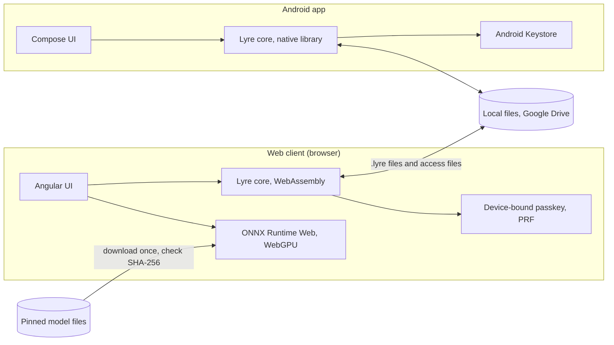

# Lyre architecture

This is the target structure. Sections marked *(planned for Mx)* describe work
that has not been built yet, as defined in
[delivery.md](delivery.md#keeping-the-docs-current). Decisions referenced as
Dn are in [decisions.md](decisions.md).

## Overview



- **Lyre core** is one Rust library (D10). It owns everything both clients
  must agree on: the song file format, encryption, access files, device
  codes, lyric parsing, forced alignment, display line layout, timing, and
  the pinned model files with the check of a download against them. It also
  does the separator's STFT, its inverse and any normalisation around the
  model, and the aligner's output check and vocabulary
  reading. Both clients call it; neither has its own copy of
  this logic.
- **The web client** is a static site (D9). Its UI, media playback and model
  runs are in TypeScript. The UI is Angular with Angular Material (D19),
  built by the rules in [UI conventions](ui-conventions.md). It calls the
  core compiled to WebAssembly. It reads and decodes sources with
  Mediabunny, which is under MPL-2.0. Mediabunny is used unmodified from npm,
  and its licence notice ships in the build's `3rdpartylicenses.txt`.
- **The Android app** is native Kotlin. Its UI and media playback use the
  Android stack. It plays and receives songs and runs no models
  ([D27](decisions.md#d27-the-android-app-plays-and-receives-songs--agreed)).
  It calls the core as a native library through UniFFI.
- **There is no Lyre server** (D9). Song files and access files move between
  devices however people choose: a shared Drive folder, a chat, a USB stick.
- **Models** are checked by the core against their pinned size and SHA-256
  hash. The client feeds a download to the core in pieces, and the check
  passes only when both match. The web client downloads each file from
  Hugging Face over HTTPS on first use
  ([D21](decisions.md#d21-pinned-model-files-and-the-separator-target--agreed)),
  streaming it to the check and to a `models/` folder in the browser's origin
  private file system (OPFS). It keeps a file only when it passes, and checks
  it again each time it is loaded, because nothing authenticates that storage.
  A file that fails is deleted and never used. The Android app downloads
  no models (D27). The [models reference](reference/models.md) lists
  the pinned files.

## Repository layout

```text
core/                 Rust workspace
  lyre-core/          song file format, crypto, access files, lyrics, alignment, layout,
                      timing, model check, separator spectrogram, aligner vocabularies
  lyre-wasm/          WebAssembly bindings for the web client
  lyre-ffi/           UniFFI bindings for the Android app
  lyre-cli/           developer tool: build and inspect song files, used by tests
web/                  web client: TypeScript, Angular, Angular Material
android/              Android app: Kotlin, Jetpack Compose, Media3
tests/
  e2e/                Playwright journeys against the built web client
  fixtures/           small sources, lyrics, expected timing and test model files for tests
scripts/              one script per check, shared by CI and NexKit
tools/
  model-tool/         developer tool: makes and checks model ONNX files, run by hand
```

Folders are created when the first issue needs them. M0 created `core/` with
`lyre-core`, `lyre-wasm` and `lyre-ffi`, plus `web/`, `android/`, `tests/e2e`
and `scripts/`. M1 added `core/lyre-cli` and `tests/fixtures`, and rebuilt
`web/` on Angular. The [lyre-cli reference](reference/lyre-cli.md) describes
the tool and the fixtures. `tools/model-tool` was added for the M2 model
measurement page. Its [reference](reference/model-tool.md) describes it.
The [models reference](reference/models.md) lists the model files and the
page's measurement method.

## Core rules

- **One implementation.** Anything both clients must do the same way lives in
  the core: parsing, the file format, crypto, layout and timing. A client
  only renders, plays and runs models.
- **No platform code in the core.** The core does no file, network, media or
  GPU work. Clients pass it bytes and call back with bytes. This keeps it
  testable on any machine and the same on both clients.
- **Bounded input.** Every parser in the core has explicit size and count
  limits and rejects input beyond them. Song files come from other people, so
  every byte is untrusted until authenticated.
- **Lyrics are untrusted text.** Lyrics come from other people's song
  files. Both clients render them as text, never as HTML or other markup.
  The web client also turns on Trusted Types and sets a Content Security
  Policy. How it sets that policy without HTTP headers is
  in [knowledge](domain/knowledge.md#running-on-the-users-device).
- **Content keys and private keys never reach JavaScript or Kotlin.** They
  are handled only inside the core and the platform key store. The core's
  API never returns one to a client. The web device key is returned as an
  opaque handle that the client cannot read. Content keys follow later in
  M3. They never reach web UI state,
  Compose state, logs or error messages.

## Song file *(encrypted from M3)*

A `.lyre` file holds one song:

- a fixed header: a magic number, the format version and the song's ID,
  plus a fresh random 256-bit salt on each write from M3;
- the media in chunks: the video if there is one, the karaoke track and the
  original track;
- the lyrics exactly as supplied, the timing, the song's details and its
  thumbnail;
- from M3, the content key wrapped for the owner's recovery key.

Display lines are not stored. The core lays them out at play time (D17).

From M3 every chunk is encrypted and authenticated with AES-256-GCM.
HKDF-SHA256 derives the file's encryption keys from the song's content key
and the per-write salt. A player can seek by decrypting only the chunks it
needs, and a changed or truncated file is rejected. Format version 0, used
in M1 and M2, is unencrypted, for development only, and is no longer accepted
from M3. No version-0 file is ever published.

The byte layout, limits and media codecs are specified in
[song file format, version 0](reference/song-file-format-v0.md).
The encrypted layout, keys and recovery wrap are specified in
[song file format, version 1](reference/song-file-format-v1.md)
*(planned for M3)*.

## Devices and access *(planned for M3)*

- **Device key.** Created the first time Lyre runs on a device (D8):
  - Android: an EC P-256 key pair in Android Keystore, hardware backed,
    not exportable. Lyre checks its attestation.
  - Web: a device-bound passkey with the PRF extension. The PRF output is
    available only after the user unlocks the device. The core derives the
    device key once per session: PRF → HKDF-SHA256 → P-256 private key.
    - The browser hands the PRF output to JavaScript. This is the
      only time a secret passes through JavaScript. The client passes it
      straight to the core, then overwrites the buffer with zeros. It never
      keeps the output in state, storage or logs. Clearing is best effort,
      because the JavaScript engine may keep copies.
- **Device code.** The compressed P-256 public key in Bech32m with the `lyre`
  prefix and a version, as text and a QR code. A fingerprint from SHA-256 of
  the public key shows 20 digits in groups of 4, for checking by voice or eye.
- **Wrapping.** A song's content key is wrapped for a device with HPKE
  (RFC 9180) base mode: DHKEM(P-256, HKDF-SHA256), HKDF-SHA256 and AES-256-GCM.
  The song ID, device code and owner or recipient role are bound into the
  HPKE info.
- **Access file.** A `.lyrekey` file is for one device and holds the wrapped
  content keys of one or more songs, each marked as the owner's or a
  recipient's. Entries are matched to song files by song ID, never by file
  name or folder. The song file does not change when it is shared (D6).
- **Recovery key.** Created before the first song, shown once as 24 BIP39
  English words and a QR code, and kept offline. The device keeps only the
  public part. Its wrap is stored inside each song file whenever the file is
  written, so a new device can be given access to all the owner's songs (D7).

The scheme is [D31](decisions.md#d31-song-files-are-encrypted-shared-and-recovered-with-one-scheme--agreed).
The [devices and access reference](reference/device-access.md) specifies
the device code, fingerprint, access file and recovery key.
The song file's encrypted layout and recovery wrap are specified in
[song file format, version 1](reference/song-file-format-v1.md)
*(planned for M3)*.

## Processing

- A task runs the stages in [knowledge](domain/knowledge.md#processing) one
  after another, on one song at a time. Tasks run only in the web client
  (D27).
- Each stage writes its output to the task's own working area. A task that
  fails, is cancelled or stops with the app removes that area and leaves no
  song behind. It can start again from the beginning.
- The web client runs a task's stages in a Web Worker, so the page stays
  responsive. Cancel ends the worker at once, because a model run cannot stop
  partway through when asked.
- On the web, a task's working area is a `tasks/<task ID>` folder in the
  browser's origin private file system (OPFS). The web client removes any
  working area left behind each time it starts.
- On the web, a browser lock named `lyre-task` keeps one task at a time across
  tabs. The startup cleanup waits for it, so it never removes the area of a
  task still running in another tab.
- On the web, stage 1, reading the source, runs on the main thread as soon as
  a source is picked, on the source check page and in the Make a song section
  of the main page. A task runs it again in its worker. It reads only the
  container and decodes nothing. Mediabunny reads MP4, WebM and MP3. It reads
  a WebM's tags, but not the segment title where ffmpeg writes a WebM title.
  The core works out the stored type D24 gives the primary video track and
  the primary audio track, from Mediabunny's codec name and codec string. The
  web client asks `MediaSource.isTypeSupported`, as the Player does, and
  refuses the source when a track has no stored type or this browser cannot
  play it. MP3 is stored as `audio/mp4; codecs="mp4a.6B"`.
- On the web, stage 2 decodes the source's audio with Mediabunny through
  WebCodecs, piece by piece, so neither the source nor the decoded audio is
  held whole. A streaming resampler in the web client gives 44.1 kHz stereo
  for separation or 16 kHz mono for alignment. Time counts from the
  timeline's start: audio that starts later gets leading silence. Audio the
  browser cannot decode gets the no-audio refusal. For now it runs on the main
  thread from the source check page, and in a Web Worker from the separation
  check page and in a task.
- On the web, stage 8 repackages the source's primary audio into the
  original track with Mediabunny, in a Web Worker, from the source check page
  and in a task. The coded packets are copied as they are. The track is WebM or
  fragmented MP4, by the stored type the core gives it, and its times are
  shifted to the timeline's start. Audio whose first frame comes more than
  50 ms after that start is refused. Mediabunny writes Clusters or fragments
  of about 1 s, and the web client groups them into media segments of up to
  10 s. It checks the format's limits, which the core's writer checks again.
  The same worker can then make the karaoke track. A task makes it from the
  karaoke track separation gave, resampled to 48 kHz. The source check page
  makes it from a second picked file that stands in for it, decoded at 48 kHz
  stereo on its own timeline. Either is fitted to the original track's end
  with silence or a cut, and encoded to Opus at 128 kbps through WebCodecs.
  Mediabunny writes one Cluster per Opus packet. The web client cuts the
  track at the packet edge nearest each of the original track's cuts, so
  both tracks have the same number of segments, each start and end within
  50 ms. A packet
  that starts at the original's end, which the encoder adds for the audio it
  held back, is left out. The page checks that the browser can encode Opus
  before it starts the worker. The same worker then repackages the source's
  primary video into the video track, by the stored type the core gives it.
  Its coded packets are copied as they are, and its times are shifted like
  the audio's. Mediabunny starts a Cluster or fragment at every keyframe, and
  the web client groups them into media segments of up to 20 s and 64 MiB, so
  each segment starts on a keyframe. A source is refused when its keyframes
  are more than 20 s apart, when one group of frames is over 64 MiB, or when
  its video does not start on a keyframe. Video whose first frame comes more
  than 50 ms after the timeline's start is refused too. The video must end
  within 1,000 ms of the song's duration, which the core's writer checks
  again. An audio-only source gives no video.
- On the web, stage 9 writes the song file in a task, with the timing from
  alignment. The source check page also writes one, in the same worker as
  stage 8, with a hand-written timing file in place of alignment. That worker
  first reads the timing file against the lyrics through the core, so a
  timing file that does not fit fails before any media work. Both then make
  the tracks and the thumbnail. They give the core, through lyre-wasm's
  `SongWriter`, the lyrics' bytes unchanged, the timing, the song details, a
  random 16-byte song ID and each track's stored type, init bytes and
  segment lengths and durations. The core's writer runs every check the
  reader runs on that plan before it gives out a byte, so the web client
  never lays out song file bytes itself. It then gives the header and index,
  and each chunk in file order. One media segment at a time passes through
  WebAssembly memory: the client hands the core a segment, and the core
  checks its length against the plan and hands it back to write. The task
  writes `song.lyre` into its own working area and reads it back to hand it
  over. The source check page's worker writes into a fresh working area under
  the `lyre-task` lock, reads the file back and removes the area. A refusal
  crosses to the page only as a fixed reason code.
- The web client runs a model with ONNX Runtime Web (MIT), at a pinned
  version, in a Web Worker. The check pages use WebGPU when the browser gives
  them a GPU adapter and the session opens on it, and otherwise WebAssembly
  on one thread. A task runs only on WebGPU, unless the page asks for
  WebAssembly with `?backend=wasm` for the journeys: it opens each session on
  that backend and never falls back. A session that cannot open on WebGPU
  fails its stage. The Make a song section checks the requirements of
  [D25](decisions.md#d25-requirements-for-making-songs--agreed) when the owner
  presses Make the song, and starts no task below them. The check runs in
  the web client, not the core, because it reads browser APIs. The model
  check page's measurement never falls back: it opens each
  session on the backend it measures, or reports why it could not. The
  worker gets only model bytes that already passed their check.
  ONNX Runtime's WebAssembly file is served from the site itself, at `ort/`,
  never from a CDN.
- On the web, stage 3, separation, runs in a Web Worker, from the separation
  check page and in a task. The worker decodes the whole source at 44.1 kHz
  stereo, because the core's separation needs all of it. The core cuts the
  audio into segments, the model runs on each, and the core joins them and
  checks the result for a broken run. Progress counts the segments done out of the total. The page
  runs the separator ([models reference](reference/models.md)), or the
  [test separator](reference/model-tool.md#make_test_separatorpy) when its
  URL asks for it. On the separation check page, only the tracks' lengths
  reach the page. The model check page's measurement runs the
  same separation once per backend, then stage 4 on that backend's vocals,
  in one Web Worker.
- On the web, stage 4, alignment, is a loop in the web client that takes the
  model runner as a function, so it is tested without ONNX Runtime. The core
  plans the windows over 16 kHz mono audio, prepares each window's input for
  the aligner, gives the frame length and turns the model's output into
  frames. It then joins the frames, times the syllables, with the same
  audio to tell where the singing stops, and runs the song file's timing
  check, so a timing the check refuses is never returned.
  Progress counts the windows done out of the total. For now, the model check
  page runs it in a Web Worker with a
  [test aligner](reference/model-tool.md#make_test_alignerspy) on test audio.
  Its measurement runs it on the separated vocals instead, mixed to mono and
  resampled to 16 kHz once per backend, with each candidate aligner in turn
  on the backend that separated them, in the same worker as the separation.
  The model's input and output names come from the core's rules for each
  aligner. The aligner opens its ONNX Runtime session through the same helper
  as the separator.
- On the web, the main page's
  [Make a song](ui-conventions.md#making-a-song) section runs a task's real
  stages, from reading the source to writing the song file, with alignment in
  place of the hand-written timing file. The finished song opens in the Player
  and is kept in the library. Each stage also runs from its check page.
- A client reports progress per stage, and a time left for the current stage
  only once that stage has run 1 s and reported some progress.
- The task logic is TypeScript in the web client, not part of the core: it is
  all worker and storage work. Given a source, its lyrics, the song details,
  the vocal role and the checked model files to use, a task runs stages 1
  to 4 and 7 to 9 in its worker and hands over the song file's bytes. It never
  picks an aligner itself. [The Make a song
  section](ui-conventions.md#making-a-song) starts it. The task check page
  still runs three test stages.
- In a task, the decoded audio, the vocals and the karaoke track from
  separation, and the timing go through the working area. The packaged
  tracks stay in the worker's JavaScript memory from stage 8 to stage 9, and
  only one media segment at a time is in WebAssembly memory. Making the
  tracks in pieces is left for a later change.
- The page loads every model file a task needs before its first stage,
  through the same download and check as the model check page, and passes the
  checked files to the worker. The task loads no model file itself. A file
  that fails its check stops the run before the task starts.
- In a task, stage 7 stores no display lines, because they are laid out at
  play time ([D17](decisions.md#d17-display-lines-are-laid-out-at-play-time--agreed)).
  It runs the song file's timing check against the lyrics and the length of
  the extracted audio.
- A failed task names its stage and one fixed reason, such as a refused
  source or a refused alignment, never
  the error's text.

## Testing

| Level | Tooling | Scope |
| --- | --- | --- |
| Core unit | `cargo test` | Format, crypto, access files, lyrics, layout, timing, with known-answer vectors |
| Core fuzz | `cargo fuzz` *(planned for M3)* | Every parser of untrusted input |
| Web unit | Vitest | Components and client logic |
| Web end to end | Playwright | The built web client in Chromium: journeys and denied access |
| Android unit | JUnit on the JVM | App logic, and the core through its Kotlin bindings |
| Android device | Instrumented tests on an emulator *(planned for M4)* | Keystore, playback and journeys |

- Every acceptance criterion maps to at least one of these.
- Tests never use real models by default. They use tiny test models or fixed
  model outputs, so the checks stay fast and run without a GPU. A separate,
  optional check runs the real models.
- Access tests check denied access as well as allowed access: a device
  without an access file, an access file for another device, a changed file.
- The exact commands were fixed in M0 and listed in [AGENTS.md](../AGENTS.md).
